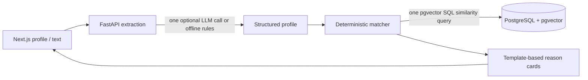

# DIGNITY — Intelligent Government Scheme & Benefits Discovery

An MVP discovery layer for Indian welfare schemes. It gives cautious, deterministic suggestions only: **“you may be eligible based on the information provided”**, never a finding of eligibility. It does not submit applications, collect payment, or store government IDs.

## Run locally

1. `docker compose up -d`
2. `cd backend; python -m venv .venv; .venv\Scripts\activate; pip install -r requirements.txt`
3. `cd backend; python -m seed.load_seed`
4. `cd backend; uvicorn app.main:app --reload`
5. In a second terminal: `cd frontend; npm install; npm run dev`
6. Open `http://localhost:3000`. API docs: `http://localhost:8000/docs`.

Use `ADMIN_TOKEN` in the backend environment and send it as `X-Admin-Token`. The default is only for local demo use.

## Architecture

`backend/seed/schemes_seed.json` is curated from the linked official myScheme pages, but every record is intentionally `verification_due`. An administrator must re-verify each entry before presenting it as verified.

## Validation

From `backend`, run `pytest -q`, then `python eval/run_eval.py`. From `frontend`, run `npm run build`. The evaluation writes its honest fixture metrics to `backend/eval/results.md`.

## Screenshots

After launching the local frontend, capture landing, profile, recommendations, and scheme-detail pages with Playwright into [`docs/screenshots`](docs/screenshots/.gitkeep). The directory is committed as a target; captures require a running local app.
